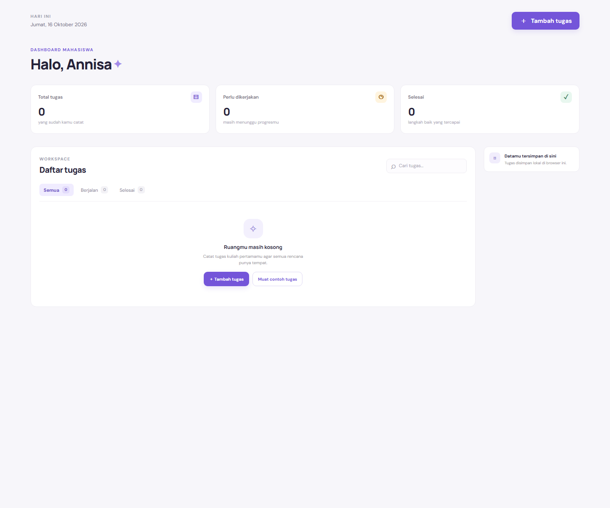

# Ruang Belajar — Personal Dashboard

## Identitas

- Nama: Annisa Afrida
- NIM: 124140121
- Mata kuliah: Pengembangan Aplikasi Web
- Pertemuan: 2 — JavaScript Next Gen (ES6+)

## Tentang aplikasi

Ruang Belajar adalah dashboard sederhana untuk membantu mahasiswa mencatat dan mengatur tugas kuliah. Setiap tugas memiliki nama, mata kuliah, tenggat, prioritas, dan catatan. Data disimpan di `localStorage`, sehingga tetap tersedia saat halaman dibuka kembali di browser yang sama.

## Fitur

- Menambah, mengedit, dan menghapus tugas.
- Menandai tugas selesai atau mengembalikannya ke daftar aktif.
- Melihat ringkasan jumlah tugas dan memfilter tugas berdasarkan status.
- Mencari tugas berdasarkan nama, mata kuliah, atau catatan.
- Melihat tenggat hari ini, besok, dan tugas yang terlambat.
- Mengimpor hingga lima contoh tugas dari JSONPlaceholder secara asinkron. Tugas hasil impor dapat diedit atau dihapus seperti tugas lainnya.
- Tampilan responsif untuk desktop dan layar ponsel.

## Cara menjalankan

1. Buka folder `Annisa Afrida_124140121_pertemuan2` di VS Code.
2. Jalankan `index.html` menggunakan ekstensi Live Server, atau buka langsung di browser modern.
3. Tambahkan tugas melalui tombol **Tambah tugas**. Perubahan tersimpan otomatis di browser.

Aplikasi tidak memerlukan instalasi paket atau API key. Contoh tugas diambil dengan `GET https://jsonplaceholder.typicode.com/todos?_limit=5` setelah pengguna memilih tombol **Muat contoh tugas**. Data tugas pribadi tidak dikirim ke layanan tersebut.

## Screenshot

## Implementasi ES6+

Lokasi berikut merujuk pada `script.js`.

| Fitur | Implementasi |
| --- | --- |
| `let` dan `const` | `const` untuk nilai tetap dan `let` untuk daftar tugas yang difilter ulang (baris 1–3, 225–234) |
| Arrow functions | Event handler serta callback `filter`/`map` (baris 105–122, 183–234) |
| Template literals | Pencarian, pesan kosong, dan rendering kartu tugas (baris 230, 280–315, 318–328) |
| Async/await | Mengambil contoh tugas dengan `fetch()` pada `loadSampleTasks()` (baris 342–378) |
| Classes | `TaskItem` untuk model tugas dan `DashboardApp` untuk state serta interaksi (baris 9–37, 39–44) |
| Destructuring | Parameter constructor dan data contoh dari API (baris 10–19, 354) |
| Spread operator | Menambahkan data API tanpa mengubah array sebelumnya (baris 367) |
| Optional chaining / nullish coalescing | Nilai default untuk data tugas dan ID (baris 11–18, 31, 133–140) |

## Penyimpanan data

Data tugas disimpan dengan kunci `ruangBelajarTasks` di `localStorage` browser. Data hanya tersedia pada browser dan perangkat tempat tugas dibuat. Menghapus data situs/browser akan menghapus salinan lokal tersebut.
