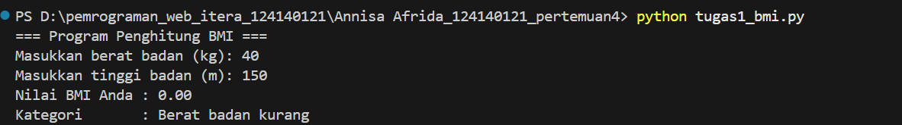
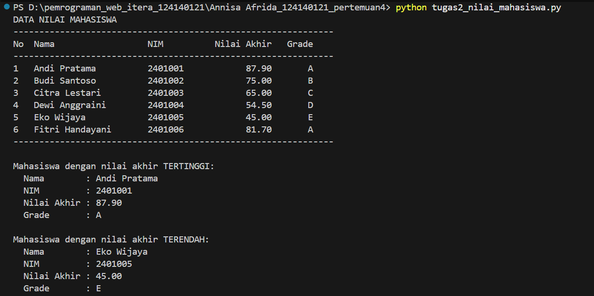
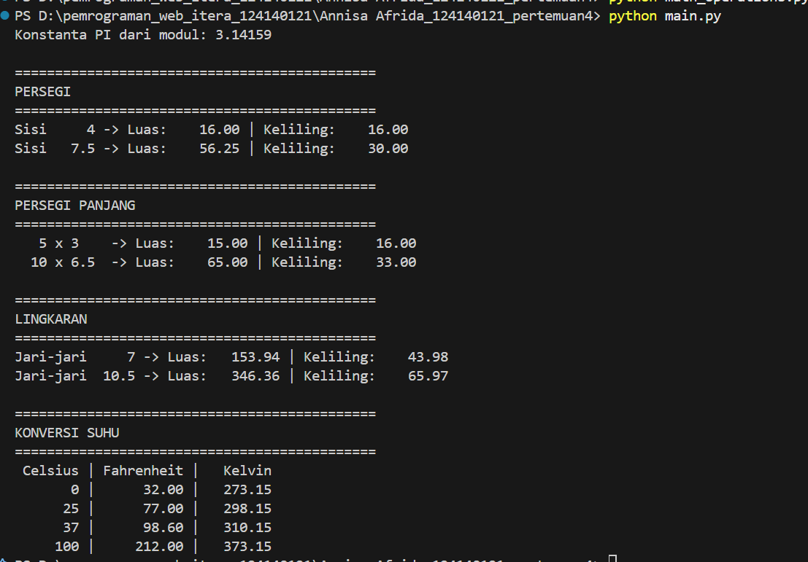

# Tugas Praktikum Dasar Pemrograman Python (Pertemuan 4)

## Identitas Mahasiswa
- **Nama** : ANNISA AFRIDA
- **NIM**  : 124140121

## Struktur Folder
```
[NAMA]_[NIM]_pertemuan4/
├── .gitignore
├── README.md
├── tugas1_bmi.py
├── tugas2_nilai_mahasiswa.py
├── math_operations.py
└── main.py
```

## Deskripsi Program

### Soal 1 - Penghitung BMI (`tugas1_bmi.py`)
Program meminta input berat badan (kg) dan tinggi badan (m) melalui `input()`,
lalu menghitung BMI dengan rumus `berat / (tinggi * tinggi)`. Kategori
ditentukan dengan `if-elif-else`:

| BMI            | Kategori             |
|----------------|----------------------|
| < 18.5         | Berat badan kurang   |
| 18.5 - < 25    | Berat badan normal   |
| 25 - < 30      | Berat badan berlebih |
| >= 30          | Obesitas             |

Hasil BMI dicetak dengan 2 angka desimal menggunakan f-string.

### Soal 2 - Pengelolaan Nilai Mahasiswa (`tugas2_nilai_mahasiswa.py`)
Data 6 mahasiswa disimpan dalam sebuah `list` berisi `dictionary` (kunci:
`nama`, `nim`, `nilai_uts`, `nilai_uas`, `nilai_tugas`). Program:
1. Menghitung nilai akhir = 30% UTS + 40% UAS + 30% Tugas.
2. Menentukan grade A-E sesuai rentang nilai.
3. Menampilkan tabel (Nama, NIM, Nilai Akhir, Grade) dengan perataan f-string.
4. Mencari dan menampilkan mahasiswa dengan nilai akhir tertinggi dan terendah
   menggunakan `max()` dan `min()`.

### Soal 3 - Modul Matematika (`math_operations.py` & `main.py`)
- `math_operations.py` berisi konstanta `PI`, fungsi luas dan keliling
  (persegi, persegi panjang, lingkaran), serta konversi suhu (Celsius ke
  Fahrenheit dan Celsius ke Kelvin).
- `main.py` mengimpor modul dengan dua cara: `import math_operations` dan
  `from math_operations import ...`, memanggil seluruh fungsi dengan berbagai
  nilai uji, lalu mencetak hasil dalam format rapi.

## Cara Menjalankan
Pastikan Python 3 terpasang, lalu jalankan dari dalam folder proyek:

```bash
python tugas1_bmi.py
python tugas2_nilai_mahasiswa.py
python main.py
```

(Pada Linux/macOS gunakan `python3` jika `python` tidak tersedia.)

## Screenshot Hasil Eksekusi

**Soal 1**



**Soal 2**



**Soal 3**

