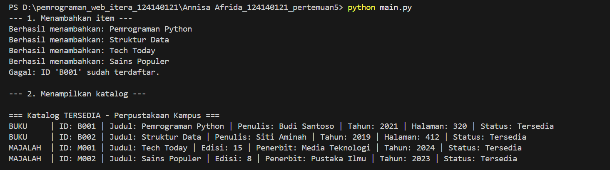
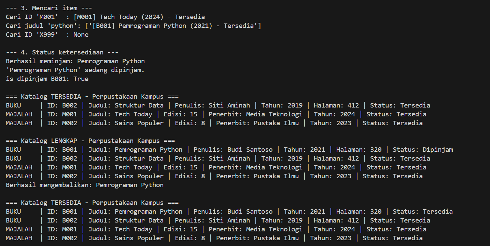
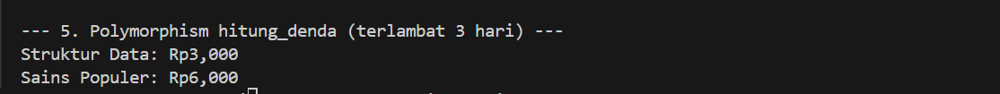

# Tugas Praktikum: Sistem Manajemen Perpustakaan Sederhana (Python OOP)

## Identitas Mahasiswa
- **Nama Lengkap**: Annisa Afrida
- **NIM**: 124140121
- **Kelas Praktikum**: RA

## Deskripsi Program

Program ini adalah sistem perpustakaan sederhana berbasis OOP Python. Alur program (`main.py`):

1. Membuat objek `Library`.
2. Menambahkan beberapa `Book` dan `Magazine` (termasuk uji ID duplikat yang ditolak).
3. Menampilkan katalog item yang tersedia.
4. Mencari item berdasarkan ID dan judul.
5. Meminjam dan mengembalikan item untuk mendemonstrasikan status ketersediaan.
6. Menghitung denda keterlambatan untuk memperlihatkan polymorphism.

### Struktur Folder
```
.
├── README.md
├── .gitignore
├── screenshots/          <- bukti tangkapan layar output
└── tugas_perpustakaan/
    ├── library_item.py   <- abstract class LibraryItem, Book, Magazine
    ├── library.py        <- class Library (pengelola koleksi)
    ├── main.py           <- skrip pengujian seluruh fitur
    └── output.txt        <- salinan teks output program
```

### Penerapan 4 Pilar OOP
- **Class**: `LibraryItem`, `Book`, `Magazine`, dan `Library` masing-masing memiliki atribut dan method sesuai tanggung jawabnya.
- **Inheritance**: `Book` dan `Magazine` mewarisi `LibraryItem(ABC)`. Abstract method `get_detail()` dan `hitung_denda()` wajib diimplementasikan kedua subclass. Atribut dan method umum (`pinjam()`, `kembalikan()`, `status()`) diwarisi dari parent.
- **Encapsulation**: `_item_id`, `_title`, `_year` bersifat protected; `__is_dipinjam` di `LibraryItem` dan `__koleksi` di `Library` bersifat private. Status peminjaman hanya dapat diubah lewat `pinjam()` dan `kembalikan()`, dan dibaca lewat `@property is_dipinjam` (read-only).
- **Polymorphism**: `Library.tampilkan_katalog()` memanggil `get_detail()` pada setiap item tanpa peduli tipenya, dan hasilnya berbeda untuk buku dan majalah. Begitu pula `hitung_denda()` (buku Rp1.000/hari, majalah Rp2.000/hari).

## Panduan Menjalankan Program

Pastikan Python 3 sudah terpasang, lalu buka terminal di folder repositori:

```bash
cd tugas_perpustakaan
python main.py
```

(Gunakan `python3` atau `py` jika `python` tidak dikenali.)

## Screenshot Output





