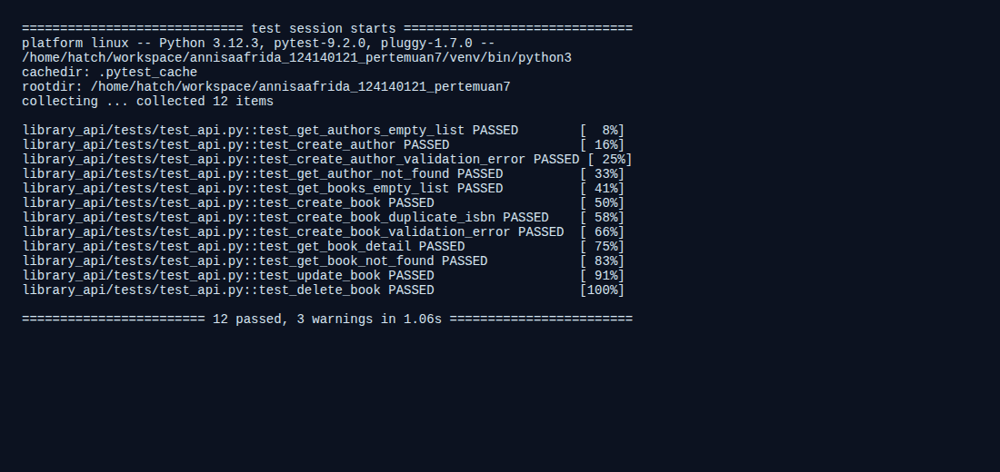
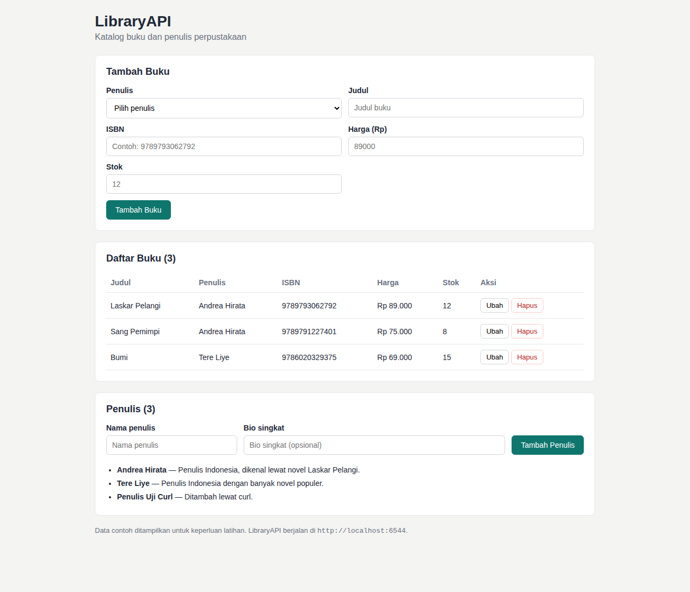
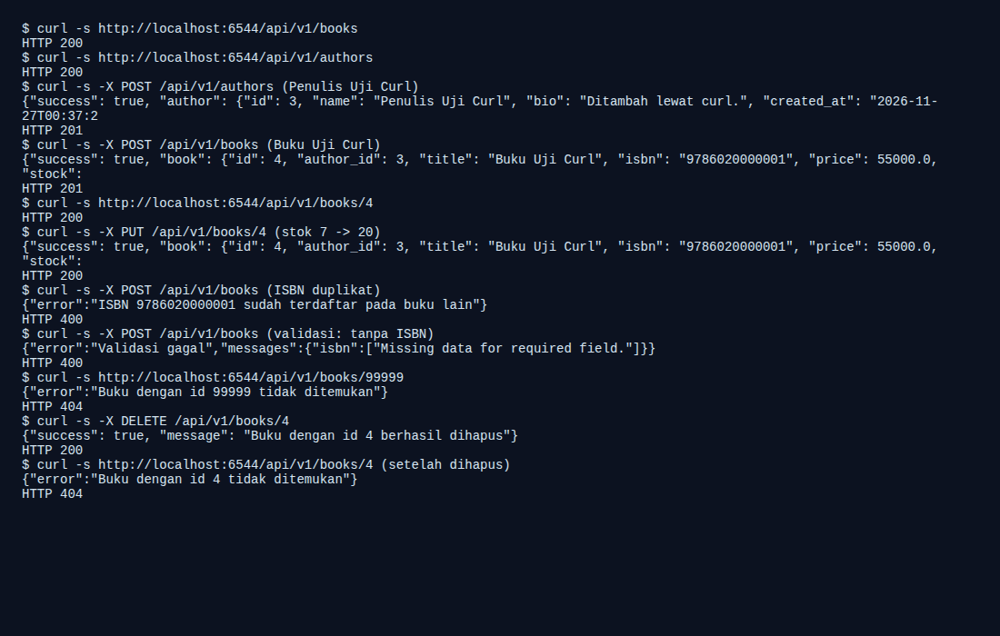

# LibraryAPI — Author dan Book

REST API perpustakaan yang dibangun dengan Pyramid, SQLAlchemy, Alembic, dan Marshmallow. Praktikum Pengembangan Aplikasi Web, Pertemuan 7: Basis Data.

## Identitas

- Nama: Annisa Afrida
- NIM: 124140121
- Kelas: RA

## Tentang Aplikasi

LibraryAPI mengelola data penulis dan buku sebuah perpustakaan. Ada dua model yang saling berelasi:

- **Author** (penulis): `name`, `bio`.
- **Book** (buku): `title`, `isbn` (unik), `price`, `stock`, dan `author_id` sebagai foreign key ke Author.

Relasinya satu-ke-banyak (1:N): satu penulis bisa menulis banyak buku, sedangkan satu buku hanya dimiliki oleh satu penulis. Relasi ini dinyatakan di model dengan `ForeignKey('authors.id')` pada Book dan `relationship` dua arah (`Author.books` dan `Book.author`). Menghapus penulis yang masih punya buku aktif akan ditolak, dan menghapus buku memakai soft delete (`is_active = False`) supaya datanya tetap tersimpan di tabel.

## Endpoint

| Method | Endpoint | Keterangan |
| ------ | -------- | ---------- |
| GET | `/api/v1/authors` | Daftar semua penulis |
| GET | `/api/v1/authors/{id}` | Detail satu penulis |
| POST | `/api/v1/authors` | Tambah penulis |
| PUT | `/api/v1/authors/{id}` | Ubah penulis |
| DELETE | `/api/v1/authors/{id}` | Hapus penulis (soft delete) |
| GET | `/api/v1/books` | Daftar semua buku |
| GET | `/api/v1/books/{id}` | Detail satu buku |
| POST | `/api/v1/books` | Tambah buku |
| PUT | `/api/v1/books/{id}` | Ubah buku |
| DELETE | `/api/v1/books/{id}` | Hapus buku (soft delete) |

Contoh body POST `/api/v1/books`:

```json
{
  "author_id": 1,
  "title": "Laskar Pelangi",
  "isbn": "9789793062792",
  "price": 89000,
  "stock": 12
}
```

Validasi memakai Marshmallow: nama dan judul wajib diisi, ISBN 10-20 karakter dan tidak boleh sama dengan buku lain, harga dan stok tidak boleh negatif, dan `author_id` harus merujuk ke penulis yang ada. Bila validasi gagal, API menjawab 400; bila id tidak ditemukan, menjawab 404.

## Instalasi

```bash
python3 -m venv venv
source venv/bin/activate
pip install -e ".[testing]"
```

## Konfigurasi (.env)

Salin `.env.example` menjadi `.env`, lalu sesuaikan isinya:

```bash
cp .env.example .env
```

```env
DB_USER=postgres
DB_PASSWORD=postgres
DB_HOST=localhost
DB_PORT=5432
DB_NAME=library_api_db
```

Buat dulu databasenya di PostgreSQL:

```sql
CREATE DATABASE library_api_db;
```

File `.env` tidak ikut diunggah ke Git.

## Migrasi Database (Alembic)

Membuat file migrasi baru dari model:

```bash
alembic -c development.ini revision --autogenerate -m "Pesan migrasi"
```

Menerapkan migrasi ke database:

```bash
alembic -c development.ini upgrade head
```

URL database untuk migrasi dibaca dari `.env` lewat `library_api/config.py`.

## Mengisi Data Contoh

```bash
initialize_library_api_db development.ini
```

Perintah ini mengisi dua penulis contoh beserta tiga buku contoh. Bila data sudah ada, perintah ini tidak menambah data lagi. Data contoh ini hanya untuk keperluan latihan.

## Menjalankan Server

```bash
pserve development.ini
```

Server berjalan di `http://localhost:6544`. Buka alamat itu di browser untuk melihat daftar endpoint.

## Menjalankan Pengujian

```bash
pytest -v
```

Pengujian memakai SQLite in-memory (lewat `testing.ini`) dan WebTest. Ada 12 test yang menguji endpoint authors dan books: daftar, detail, tambah, ubah, hapus, validasi input, ISBN duplikat, dan id yang tidak ditemukan.



## Menjalankan Frontend (React)

Frontend berada di folder `frontend/` dan memakai Vite.

```bash
cd frontend
npm install
npm run dev -- --port 5174
```

Buka `http://localhost:5174`. Pastikan dulu server backend (`pserve`) sedang berjalan, karena frontend mengambil data dari API di `http://localhost:6544`.

Untuk build produksi:

```bash
npm run build
```

## Screenshot




